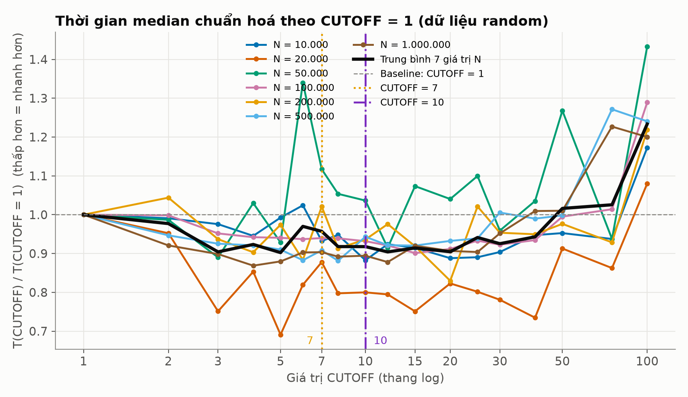
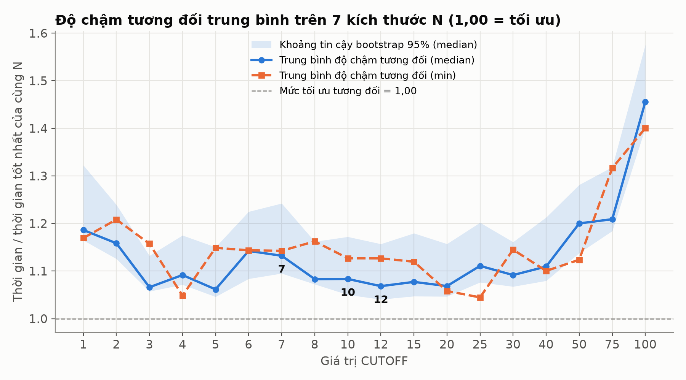
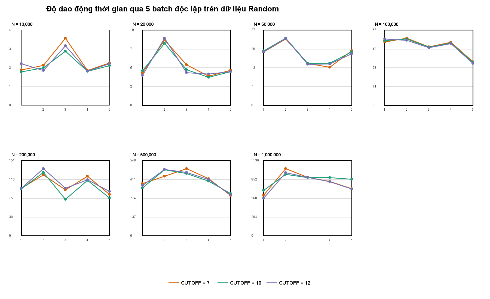
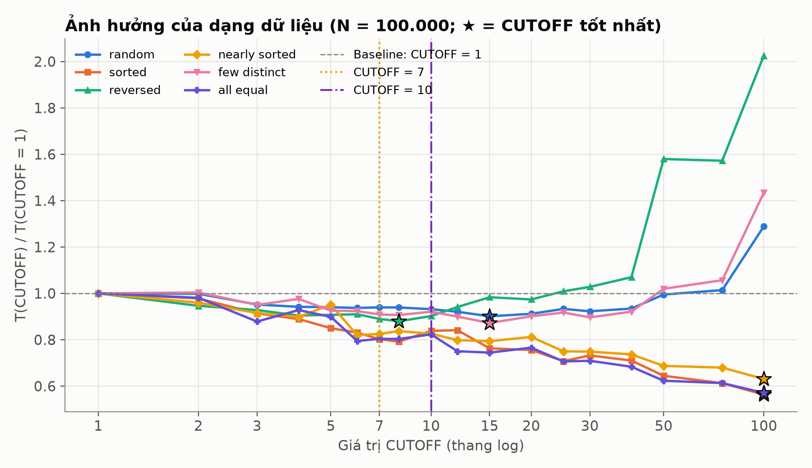

# BÁO CÁO THÍ NGHIỆM

## Xác định giá trị CUTOFF phù hợp cho MergeSort

**Thực nghiệm đo thời gian với InsertionSort cho mảng con nhỏ**  

**Họ và tên:** Đặng Đức Phú  

**MSSV:** 25020316  

**Lớp:** K70I-IT1  

**Môn học:** Cấu trúc dữ liệu và giải thuật

## 1. Giới thiệu và mục tiêu

MergeSort có thể được cải tiến bằng cách chuyển sang InsertionSort khi mảng con đủ nhỏ. Ngưỡng chuyển đổi được gọi là CUTOFF. Giáo trình thường đề cập CUTOFF = 7 và CUTOFF = 10, nhưng giá trị phù hợp phụ thuộc vào cách cài đặt, cấu hình máy, kích thước và phân phối dữ liệu.

Báo cáo này trả lời câu hỏi: với bản cài đặt MergeSort theo bài giảng và máy thực nghiệm hiện tại, CUTOFF nào cho thời gian chạy tốt; CUTOFF = 7 và CUTOFF = 10 có nằm trong vùng hợp lý hay không?

Cách thực hiện là khảo sát 18 giá trị CUTOFF trên 13 bộ dữ liệu, gồm 7 kích thước random và 6 dạng dữ liệu đặc biệt. Lần chạy đơn dùng 10 lần đo cho mỗi CUTOFF. Sau đó, để kiểm tra độ ổn định, project chạy thêm 5 batch độc lập, mỗi batch 20 lần đo cho mỗi CUTOFF.

Kết luận ngắn: CUTOFF tốt nhất thay đổi theo dataset. Ở nhóm random, lần chạy đơn cho các giá trị lần lượt là 10, 5, 3, 15, 20, 8, 4 khi N tăng từ 10.000 đến 1.000.000. Qua 5 batch, giá trị ổn định lần lượt là 10, 20, 15, 25, 15, 8, 4. Không có một giá trị duy nhất thắng mọi trường hợp; CUTOFF = 10 vẫn là mặc định hợp lý theo giáo trình, còn CUTOFF = 25 đứng đầu khi chuẩn hóa toàn bộ nhóm random trong thí nghiệm này.

## 2. Cơ sở lý thuyết

### 2.1. MergeSort top-down

MergeSort top-down làm việc trên một đoạn `[lo, hi]` theo ba bước:

1. Nếu đoạn chỉ còn một phần tử thì dừng vì đoạn đó đã có thứ tự.
2. Tính `mid = lo + (hi - lo) / 2`, sau đó gọi đệ quy cho `[lo, mid]` và `[mid + 1, hi]`.
3. Gọi `merge` để trộn hai nửa đã được sắp xếp thành một đoạn có thứ tự.

Trong bước `merge`, đoạn `[lo, hi]` được sao chép sang mảng phụ `aux`. Hai con trỏ `i` và `j` lần lượt trỏ đến đầu hai nửa. Ở mỗi vị trí kết quả, thuật toán chọn phần tử nhỏ hơn trong `aux[i]` và `aux[j]`; nếu một nửa đã hết thì lấy phần tử từ nửa còn lại. Việc dùng mảng phụ giúp thao tác trộn tuyến tính và giữ đúng thứ tự tương đối của các phần tử bằng nhau.

Đoạn code tương ứng trong `Merge.java` là:

```java
private static void merge(Comparable[] a, Comparable[] aux,
                          int lo, int mid, int hi) {
    for (int k = lo; k <= hi; k++)
        aux[k] = a[k];

    int i = lo, j = mid + 1;
    for (int k = lo; k <= hi; k++) {
        if (i > mid)                   a[k] = aux[j++];
        else if (j > hi)               a[k] = aux[i++];
        else if (less(aux[j], aux[i])) a[k] = aux[j++];
        else                           a[k] = aux[i++];
    }
}
```

Với đoạn có kích thước `n`, thời gian trộn là `Θ(n)`. Nếu `T(n)` là thời gian MergeSort, ta có truy hồi:

```text
T(n) = 2T(⌊n/2⌋) + Θ(n)
T(1) = Θ(1)
```

Theo định lý Master, `T(n) = Θ(n log₂ n)` ở cả trường hợp tốt, trung bình và xấu. Mảng phụ có kích thước `N`, nên bộ nhớ phụ là `Θ(N)`, chưa tính ngăn xếp đệ quy `Θ(log₂ N)`.

### 2.2. InsertionSort trên đoạn con

InsertionSort duyệt đoạn từ trái sang phải. Tại vị trí `i`, thuật toán đưa `a[i]` về vị trí phù hợp trong phần đã sắp xếp ở bên trái bằng các phép đổi chỗ liên tiếp:

```java
for (int i = lo; i <= hi; i++)
    for (int j = i; j > lo && less(a[j], a[j - 1]); j--)
        exch(a, j, j - 1);
```

Với đoạn có `k` phần tử, số lần so sánh và đổi chỗ phụ thuộc vào số nghịch thế. Trường hợp tốt, khi đoạn đã tăng dần, chi phí là `Θ(k)`. Trường hợp xấu, khi đoạn giảm dần, chi phí là `Θ(k²)`, xấp xỉ `k(k - 1) / 2` lần dịch chuyển/đổi chỗ. Trường hợp trung bình trên dữ liệu random cũng có bậc hai theo `k`, nhưng hệ số của đoạn rất nhỏ có thể thấp hơn chi phí cố định của một mức MergeSort.

InsertionSort có ưu điểm là không cần mảng phụ, thao tác tuần tự trên bộ nhớ và tận dụng tốt đoạn đã gần có thứ tự. Đây là lý do nó phù hợp để xử lý các lá của cây đệ quy MergeSort.

Trong project, InsertionSort được cài đặt bằng đổi chỗ hai phần tử kề nhau, không dùng phiên bản dịch chuyển phần tử:

```java
public static void sort(Comparable[] a, int lo, int hi) {
    for (int i = lo; i <= hi; i++)
        for (int j = i; j > lo && less(a[j], a[j - 1]); j--)
            exch(a, j, j - 1);
}
```

### 2.3. MergeSort có CUTOFF

Trong cài đặt có CUTOFF, điều kiện dừng là:

```java
if (hi <= lo + cutoff - 1) {
    Insertion.sort(a, lo, hi);
    return;
}
```

Phần đệ quy đầy đủ của phiên bản CUTOFF là:

```java
private static void sort(Comparable[] a, Comparable[] aux,
                         int lo, int hi, int cutoff) {
    if (hi <= lo + cutoff - 1) {
        Insertion.sort(a, lo, hi);
        return;
    }

    int mid = lo + (hi - lo) / 2;
    sort(a, aux, lo, mid, cutoff);
    sort(a, aux, mid + 1, hi, cutoff);
    merge(a, aux, lo, mid, hi);
}
```

CUTOFF = 1 tương ứng với MergeSort thuần: chỉ các đoạn một phần tử đi vào InsertionSort, nên không tạo ra phần việc đáng kể. Khi `k = CUTOFF` tăng, cây đệ quy dừng ở độ sâu nhỏ hơn. Số mức trộn ở phần dưới của cây giảm xấp xỉ `log₂(k)`, nhưng mỗi đoạn lá phải chịu chi phí InsertionSort.

Một mô hình gần đúng cho tổng chi phí có dạng:

```text
T(k) ≈ (aNk) / 4 - cN log₂(k) + dN
```

Trong đó thành phần thứ nhất biểu diễn chi phí InsertionSort trung bình trên các đoạn dài `k`, còn thành phần thứ hai biểu diễn phần chi phí trộn/đệ quy được tiết kiệm. Khi `k` nhỏ, phần tiết kiệm thường lớn hơn phần tăng của InsertionSort nên thời gian giảm. Khi `k` quá lớn, thành phần bậc hai chiếm ưu thế nên thời gian tăng. Đây là cơ sở lý thuyết cho đường cong gần chữ U.

Công thức chỉ là mô hình giải thích xu hướng. Không thể suy ra CUTOFF tối ưu chính xác chỉ từ công thức vì `a` và `c` phụ thuộc vào JVM, kiểu `Comparable`, cách đổi chỗ trong InsertionSort, cấp phát mảng phụ và phần cứng.

### 2.4. Tính đúng và ảnh hưởng của dữ liệu

MergeSort đúng theo quy nạp: các đoạn có kích thước 0 hoặc 1 đã được sắp xếp; nếu hai nửa đã sắp xếp thì `merge` luôn chọn phần tử nhỏ hơn tiếp theo, vì vậy đoạn sau khi trộn cũng có thứ tự. Khi dùng CUTOFF, InsertionSort thay thế phần đệ quy ở đoạn nhỏ và vẫn trả về một đoạn có thứ tự. Do đó việc thay thế không làm thay đổi tính đúng của MergeSort.

Phân phối dữ liệu ảnh hưởng đến phần InsertionSort. Với sorted hoặc nearly sorted, số nghịch thế nhỏ nên có thể tăng CUTOFF. Với reversed, số nghịch thế gần cực đại nên CUTOFF lớn dễ làm chậm. Với all equal, điều kiện so sánh thường không kích hoạt đổi chỗ; với few distinct, nhiều phần tử bằng nhau làm hình dạng chi phí khác random. Edge values chỉ thay đổi miền giá trị, không thay đổi bản chất vì thuật toán chỉ sử dụng phép so sánh.

Vì vậy, thí nghiệm không chỉ khảo sát CUTOFF theo `N` mà còn cần nhóm dữ liệu đặc biệt. Kết quả thực nghiệm dùng để kiểm tra mô hình lý thuyết, không thay thế cho phân tích độ phức tạp tiệm cận.

## 3. Thiết kế thí nghiệm

### 3.1. Cài đặt

Mã nguồn Java được tự cài đặt theo bài giảng, không dùng thư viện sắp xếp có sẵn để thay thế thuật toán:

| Tệp | Chức năng |
|---|---|
| `Insertion.java` | InsertionSort trên đoạn `[lo, hi]`. |
| `Merge.java` | MergeSort top-down, mảng phụ và phiên bản có CUTOFF. |
| `InputGenerator.java` | Sinh các bộ dữ liệu đầu vào. |
| `BenchmarkRunner.java` | Warm-up, đo thời gian, tính median/min và ghi CSV. |
| `ResultValidator.java` | Đối chiếu kết quả với mảng chuẩn. |
| `Main.java` | Chạy sinh dữ liệu và benchmark. |

Quy ước CUTOFF = 1 là mốc MergeSort thuần vì các đoạn một phần tử đã được xem là có thứ tự.

### 3.2. Môi trường chạy

| Thông số | Giá trị |
|---|---|
| CPU | 12th Gen Intel(R) Core(TM) i7-1265U, 2.70 GHz |
| RAM | 16 GB, 5200 MT/s |
| Hệ điều hành | Windows 10 Pro, version 26H2, build 26300.9974 |
| Java/JVM | Java 25.0.2 LTS, HotSpot 64-Bit Server VM |
| Cách đo | `System.nanoTime()`, chỉ đo lời gọi `Merge.sort` |
| Seed sinh dữ liệu | `20261116` |

### 3.3. Bộ dữ liệu

| Dạng dữ liệu | N | Mô tả |
|---|---:|---|
| Random | 10.000 đến 1.000.000 | Số nguyên giả ngẫu nhiên trong miền 0 đến 1.000.000.000. |
| Sorted | 100.000 | Đã sắp xếp tăng dần. |
| Reversed | 100.000 | Đã sắp xếp giảm dần. |
| Nearly sorted | 100.000 | Mảng tăng dần, sau đó hoán đổi khoảng 1% vị trí. |
| Few distinct | 100.000 | Chỉ có 10 giá trị phân biệt. |
| All equal | 100.000 | Mọi phần tử bằng 0. |
| Edge values | 10.000 | Có các giá trị `Integer.MIN_VALUE`, -1, 0 và `Integer.MAX_VALUE`. |

### 3.4. Quy trình đo

- Khảo sát 18 giá trị: 1, 2, 3, 4, 5, 6, 7, 8, 10, 12, 15, 20, 25, 30, 40, 50, 75, 100.
- Lần chạy đơn: 3 vòng warm-up và 10 lần đo cho mỗi CUTOFF.
- Lần chạy lặp lại: 5 batch, mỗi batch 3 vòng warm-up và 20 lần đo cho mỗi CUTOFF.
- Thứ tự CUTOFF được xáo trộn có kiểm soát giữa các vòng đo.
- Mỗi lần đo dùng một bản sao của cùng mảng đầu vào; thời gian sao chép không tính vào thời gian thuật toán.
- Kết quả chuẩn được tạo ngoài vùng đo. Sau khi sắp xếp, chương trình kiểm tra độ dài, thứ tự và từng phần tử.
- Thống kê chính là median. Min được lưu để tham khảo tốc độ tốt nhất quan sát được.

Vùng đo trong `BenchmarkRunner` có dạng:

```java
Integer[] a = data.clone();
long start = System.nanoTime();
Merge.sort(a, cutoff);
long elapsed = System.nanoTime() - start;
times[index][run] = elapsed;
```

Việc gọi `data.clone()` nằm trước `System.nanoTime()`, còn kiểm tra `a` với mảng chuẩn nằm sau khi dừng đồng hồ. Như vậy thời gian được báo cáo là thời gian của lời gọi MergeSort hoàn chỉnh, bao gồm cấp phát mảng phụ bên trong `Merge.sort`, nhưng không bao gồm sao chép đầu vào và kiểm tra kết quả.

Với 5 batch, `mean_median_ms` là trung bình của 5 median; SD là độ lệch chuẩn mẫu; `best_batch_count` là số batch mà CUTOFF đứng đầu. Tiêu chí chính của báo cáo là CUTOFF có `mean_median_ms` nhỏ nhất trên từng dataset.

## 4. Kết quả trên dữ liệu random

### 4.1. Thời gian median theo kích thước N

Bảng dưới đây lấy từ lần chạy đơn. Các hàng được chọn để thể hiện vùng nhỏ, vùng trung tâm và hai đầu của lưới CUTOFF.

| CUTOFF | 10.000 | 20.000 | 50.000 | 100.000 | 200.000 | 500.000 | 1.000.000 |
|---:|---:|---:|---:|---:|---:|---:|---:|
| 1 | 1.940 | 5.845 | 12.606 | 25.113 | 66.865 | 422.829 | 569.088 |
| 4 | 1.835 | 4.987 | 12.982 | 23.657 | 60.397 | 389.454 | 494.417 |
| 5 | 1.926 | 4.039 | 11.706 | 23.620 | 65.133 | 384.857 | 500.633 |
| 7 | 1.809 | 5.131 | 14.081 | 23.601 | 68.271 | 384.034 | 514.170 |
| 10 | 1.713 | 4.676 | 13.065 | 23.402 | 62.584 | 398.777 | 509.021 |
| 12 | 1.793 | 4.645 | 11.532 | 23.122 | 65.244 | 389.601 | 499.639 |
| 15 | 1.775 | 4.390 | 13.533 | 22.630 | 61.429 | 389.224 | 523.684 |
| 20 | 1.723 | 4.810 | 13.115 | 22.897 | 55.485 | 394.289 | 515.946 |
| 25 | 1.728 | 4.685 | 13.863 | 23.432 | 68.288 | 397.023 | 514.383 |
| 30 | 1.754 | 4.564 | 12.089 | 23.172 | 63.761 | 425.163 | 541.721 |
| 50 | 1.848 | 5.336 | 15.985 | 24.986 | 65.285 | 422.066 | 574.908 |
| 100 | 2.275 | 6.314 | 18.067 | 32.380 | 81.475 | 524.500 | 682.960 |

Kết quả tốt nhất trong lần chạy đơn lần lượt là:

| N | CUTOFF tốt nhất | Median (ms) | Giảm so với CUTOFF = 1 |
|---:|---:|---:|---:|
| 10.000 | 10 | 1.713 | 11.70% |
| 20.000 | 5 | 4.039 | 30.90% |
| 50.000 | 3 | 11.220 | 10.99% |
| 100.000 | 15 | 22.630 | 9.89% |
| 200.000 | 20 | 55.485 | 17.02% |
| 500.000 | 8 | 372.677 | 11.86% |
| 1.000.000 | 4 | 494.417 | 13.12% |



*Hình 1. Thời gian chuẩn hóa theo CUTOFF trên các kích thước random.*

Đường cong cho thấy CUTOFF rất lớn, đặc biệt 75 và 100, thường làm thời gian tăng. Đáy của đường cong thường phẳng, nên CUTOFF đứng đầu trong một lần chạy không nhất thiết là lựa chọn ổn định nhất.

### 4.2. Vùng gần tối ưu và ảnh hưởng của thống kê min

Để tránh diễn giải quá mức một điểm cực tiểu, gọi vùng gần tối ưu là tập các CUTOFF có thời gian không quá 102% thời gian tốt nhất của cùng N. Vùng này có thể không liên tục vì lưới CUTOFF được khảo sát rời rạc.

| N | Tốt nhất theo median | Giảm so với CUTOFF = 1 | Vùng <= 2% theo median | Tốt nhất theo min | Vùng <= 2% theo min | Chậm hơn tốt nhất khi dùng 7 / 10 / 12 (%) |
|---:|---:|---:|---:|---:|---:|---:|
| 10.000 | 10 | 11.70 | 10-25 | 25 | 10-30 | 5.60 / 0.00 / 4.67 |
| 20.000 | 5 | 30.90 | 5-5 | 25 | 10-30 | 27.04 / 15.77 / 15.00 |
| 50.000 | 3 | 10.99 | 3-3 | 12 | 12-40 | 25.50 / 16.44 / 2.78 |
| 100.000 | 15 | 9.89 | 15-20 | 10 | 6-30 | 4.29 / 3.41 / 2.17 |
| 200.000 | 20 | 17.02 | 20-20 | 15 | 10-20 | 23.04 / 12.79 / 17.59 |
| 500.000 | 8 | 11.86 | 6-8 | 4 | 4-4 | 3.05 / 7.00 / 4.54 |
| 1.000.000 | 4 | 13.12 | 4-12 | 12 | 4-12 | 4.00 / 2.95 / 1.06 |

Bảng này giải thích vì sao không nên chỉ báo cáo một CUTOFF thắng trong một lần chạy. Ở `N = 1.000.000`, vùng median gần tối ưu trải từ 4 đến 12; CUTOFF = 4 có median nhỏ nhất nhưng CUTOFF = 12 có min nhỏ nhất. Ở `N = 100.000`, vùng median từ 15 đến 20 và vùng min từ 6 đến 30, cho thấy thứ hạng phụ thuộc vào cách tóm tắt thời gian.

### 4.3. Đường median và đường min

Median đại diện cho thời gian điển hình và ít nhạy với một vài lần chạy bất thường. Min gần với tốc độ tốt nhất quan sát được nhưng dễ bị ảnh hưởng bởi một lần hệ thống ít bận. Vì vậy báo cáo dùng median làm tiêu chí chính, còn min để kiểm tra xem kết luận có giữ được khi chỉ xét những lần chạy thuận lợi hay không. Nếu median và min cùng có vùng tốt gần nhau, kết luận đáng tin hơn; nếu khác xa, cần xem đó là dấu hiệu nhiễu đo.



*Hình 2. Thời gian tăng theo kích thước mảng với các CUTOFF tiêu biểu.*

### 4.4. Tổng hợp qua 5 batch

| Dataset | CUTOFF ổn định | Mean median (ms) | SD (ms) | Batch thắng |
|---|---:|---:|---:|---:|
| `random_10000` | 10 | 2.379 | 0.965 | 2 |
| `random_20000` | 20 | 5.985 | 1.925 | 2 |
| `random_50000` | 15 | 23.994 | 7.527 | 3 |
| `random_100000` | 25 | 47.033 | 5.421 | 3 |
| `random_200000` | 15 | 112.344 | 18.179 | 2 |
| `random_500000` | 8 | 430.073 | 74.106 | 1 |
| `random_1000000` | 4 | 880.848 | 208.237 | 1 |

So với lần chạy đơn, CUTOFF ổn định thay đổi ở một số N. Đây là bằng chứng rằng vùng cực tiểu khá phẳng và nhiễu môi trường có thể đổi vị trí của giá trị đứng đầu. Với `N = 1.000.000`, CUTOFF = 4 vẫn là ứng viên tốt nhất theo mean median, nhưng SD lớn nên không nên tổng quát hóa thành giá trị tối ưu cho mọi máy.



*Hình 3. Độ dao động của CUTOFF = 7, 10 và 12 qua 5 batch.*

## 5. Tổng hợp và so sánh các CUTOFF

### 5.1. Chuẩn hóa trên toàn bộ nhóm random

Để tham khảo một giá trị chung, mỗi thời gian được chia cho thời gian tốt nhất trong cùng batch và cùng N, sau đó lấy trung bình trên 7 kích thước và 5 batch.

| CUTOFF | Mean tương đối | SD giữa batch |
|---:|---:|---:|
| 25 | 1.055994 | 0.012104 |
| 15 | 1.059201 | 0.016375 |
| 6 | 1.063566 | 0.024016 |
| 20 | 1.073122 | 0.038647 |
| 8 | 1.076688 | 0.022344 |
| 10 | 1.080576 | 0.024287 |
| 12 | 1.088586 | 0.016225 |

Theo tiêu chí chuẩn hóa này, CUTOFF = 25 là ứng viên tốt nhất cho toàn bộ nhóm random. Đây là tiêu chí phụ vì nó gộp nhiều kích thước và không đại diện cho các dạng sorted hoặc reversed. Tiêu chí chính vẫn là mean median theo từng dataset.

### 5.2. So sánh CUTOFF = 7, 10 và 12

| Dataset | CUTOFF 7 (ms) | CUTOFF 10 (ms) | CUTOFF 12 (ms) |
|---|---:|---:|---:|
| `random_10000` | 2.608 | 2.379 | 2.517 |
| `random_20000` | 6.251 | 6.162 | 6.156 |
| `random_50000` | 25.495 | 25.839 | 24.479 |
| `random_100000` | 48.001 | 48.419 | 48.509 |
| `random_200000` | 117.809 | 115.610 | 117.015 |
| `random_500000` | 432.553 | 450.811 | 448.088 |
| `random_1000000` | 905.983 | 916.680 | 882.893 |

Không có giá trị nào luôn đứng đầu. CUTOFF = 10 tốt nhất ở random_10000 và random_200000; CUTOFF = 12 tốt nhất ở random_20000, random_50000 và random_1000000; CUTOFF = 7 tốt nhất ở random_100000 và random_500000. Chênh lệch giữa ba giá trị thường nhỏ, đặc biệt so với độ dao động ở các N lớn.

### 5.3. Phân tích thống kê bổ trợ

Project có thêm bootstrap 4.000 lần và Mann–Whitney U từ 10 lần đo của lần chạy đơn. Khoảng bootstrap 95% của chênh lệch chuẩn hóa là:

| So sánh | Khoảng 95% | Nhận xét |
|---|---|---|
| 7 - 10 | -0.0366 đến 0.1478 | Chứa 0 |
| 7 - 12 | -0.0208 đến 0.1619 | Chứa 0 |
| 10 - 12 | -0.0699 đến 0.1033 | Chứa 0 |
| 1 - 12 | 0.0471 đến 0.2461 | Không chứa 0 |

Ba so sánh giữa 7, 10 và 12 đều chứa 0, nên chưa có bằng chứng rõ ràng rằng một giá trị vượt trội ổn định. So sánh 1 - 12 gợi ý dùng CUTOFF có lợi hơn MergeSort thuần trong tập random khảo sát. Tuy nhiên, bootstrap hiện tại dựa trên lần chạy đơn; các lần đo dùng chung dữ liệu, JVM và điều kiện máy, nên đây là phân tích thăm dò chứ không phải kết luận suy luận tuyệt đối. P-value Mann–Whitney cũng không được dùng độc lập để chọn CUTOFF vì chưa hiệu chỉnh nhiều phép so sánh.

## 6. Ảnh hưởng của dạng dữ liệu

| Dataset | CUTOFF tốt nhất | Tốt nhất (ms) | CUTOFF = 1 | CUTOFF = 7 | CUTOFF = 10 | CUTOFF = 12 | Giảm (%) |
|---|---:|---:|---:|---:|---:|---:|---:|
| Random 100.000 | 15 | 22.630 | 25.113 | 23.601 | 23.402 | 23.122 | 9.89 |
| Sorted 100.000 | 100 | 6.938 | 12.313 | 9.880 | 10.321 | 10.360 | 43.65 |
| Reversed 100.000 | 8 | 11.439 | 13.004 | 11.571 | 11.733 | 12.239 | 12.03 |
| Nearly sorted 100.000 | 100 | 9.127 | 14.471 | 11.945 | 11.955 | 11.553 | 36.93 |
| Few distinct 100.000 | 15 | 13.975 | 16.020 | 14.561 | 14.754 | 14.415 | 12.77 |
| All equal 100.000 | 100 | 7.146 | 12.524 | 10.070 | 10.311 | 9.399 | 42.94 |
| Edge values 10.000 | 25 | 1.723 | 1.948 | 1.770 | 1.773 | 1.761 | 11.55 |



*Hình 4. Thời gian tương đối theo dạng dữ liệu.*

Sorted, nearly sorted và all equal có xu hướng thích CUTOFF lớn vì InsertionSort làm ít dịch chuyển trên các đoạn con. Reversed phù hợp với CUTOFF nhỏ hơn vì InsertionSort gặp nhiều nghịch thế khi đoạn con dài. Few distinct nằm ở vùng trung gian. Edge values không tạo khác biệt bản chất vì thuật toán chỉ dùng phép so sánh.

## 7. Kết luận và hạn chế

### 7.1. Kết luận

1. CUTOFF tối ưu phụ thuộc vào N và dạng dữ liệu, không phải một hằng số chung cho mọi trường hợp.
2. CUTOFF quá lớn, đặc biệt 75 và 100, thường làm chậm dữ liệu random và reversed.
3. Sorted, nearly sorted và all equal có thể tiếp tục cải thiện khi tăng CUTOFF; giá trị tối ưu thật sự có thể lớn hơn 100.
4. CUTOFF = 7 và CUTOFF = 10 đều nằm trong vùng hợp lý, nhưng không có bằng chứng thống kê rõ ràng rằng một giá trị luôn tốt hơn giá trị kia.
5. Nếu cần một mặc định bám sát giáo trình, chọn CUTOFF = 10. Nếu tối ưu riêng cho nhóm random theo chuẩn hóa của thí nghiệm hiện tại, CUTOFF = 25 là ứng viên tốt nhất.

### 7.2. Hạn chế

- Thí nghiệm chỉ chạy trên một máy và một phiên bản JVM.
- Mỗi batch vẫn chịu ảnh hưởng của JIT, GC, nhiệt độ CPU và tiến trình nền.
- Có 5 batch nên SD và bootstrap chưa thể đại diện đầy đủ cho mọi điều kiện chạy.
- Bootstrap và Mann–Whitney hiện có dùng dữ liệu lần chạy đơn, chưa phải bootstrap phân cấp theo batch.
- Chưa hiệu chỉnh p-value cho nhiều phép so sánh.
- Lưới CUTOFF bị giới hạn ở 100, nên chưa xác định được giá trị tối ưu cho dữ liệu đã có thứ tự.

## Phụ lục A. Tệp kết quả và cách chạy lại

```powershell
New-Item -ItemType Directory -Force build
javac -d build (Get-ChildItem -Recurse src -Filter *.java | ForEach-Object FullName)
java -cp build Main generate data/generated 20261116
python scripts/run_experiments.py
python scripts/summarize_results.py
python scripts/plot_results.py
python scripts/run_repeated_experiments.py
python scripts/summarize_repeated.py
python scripts/plot_repeated.py
```

Kết quả lần đơn nằm ở `results/raw/` và `results/summary/`. Kết quả lặp lại nằm ở `results/repeated/`. Các biểu đồ dùng trong báo cáo nằm ở `report/figures/`.

### Bảng A1. Đầy đủ median của dữ liệu random

| CUTOFF | 10.000 | 20.000 | 50.000 | 100.000 | 200.000 | 500.000 | 1.000.000 |
|---:|---:|---:|---:|---:|---:|---:|---:|
| 1 | 1.940 | 5.845 | 12.606 | 25.113 | 66.865 | 422.829 | 569.088 |
| 2 | 1.922 | 5.566 | 12.439 | 25.071 | 69.799 | 400.318 | 524.016 |
| 3 | 1.893 | 4.391 | 11.220 | 23.902 | 62.652 | 391.247 | 511.388 |
| 4 | 1.835 | 4.987 | 12.982 | 23.657 | 60.397 | 389.454 | 494.417 |
| 5 | 1.926 | 4.039 | 11.706 | 23.620 | 65.133 | 384.857 | 500.633 |
| 6 | 1.987 | 4.789 | 16.892 | 23.531 | 59.085 | 373.206 | 513.775 |
| 7 | 1.809 | 5.131 | 14.081 | 23.601 | 68.271 | 384.034 | 514.170 |
| 8 | 1.839 | 4.661 | 13.283 | 23.585 | 61.069 | 372.677 | 507.622 |
| 10 | 1.713 | 4.676 | 13.065 | 23.402 | 62.584 | 398.777 | 509.021 |
| 12 | 1.793 | 4.645 | 11.532 | 23.122 | 65.244 | 389.601 | 499.639 |
| 15 | 1.775 | 4.390 | 13.533 | 22.630 | 61.429 | 389.224 | 523.684 |
| 20 | 1.723 | 4.810 | 13.115 | 22.897 | 55.485 | 394.289 | 515.946 |
| 25 | 1.728 | 4.685 | 13.863 | 23.432 | 68.288 | 397.023 | 514.383 |
| 30 | 1.754 | 4.564 | 12.089 | 23.172 | 63.761 | 425.163 | 541.721 |
| 40 | 1.838 | 4.294 | 13.051 | 23.469 | 63.495 | 418.547 | 574.466 |
| 50 | 1.848 | 5.336 | 15.985 | 24.986 | 65.285 | 422.066 | 574.908 |
| 75 | 1.819 | 5.041 | 11.820 | 25.468 | 62.100 | 537.590 | 698.190 |
| 100 | 2.275 | 6.314 | 18.067 | 32.380 | 81.475 | 524.500 | 682.960 |

### Bảng A2. Đầy đủ min của dữ liệu random

| CUTOFF | 10.000 | 20.000 | 50.000 | 100.000 | 200.000 | 500.000 | 1.000.000 |
|---:|---:|---:|---:|---:|---:|---:|---:|
| 1 | 1.904 | 4.690 | 11.149 | 24.290 | 55.883 | 261.826 | 527.752 |
| 2 | 1.823 | 3.945 | 11.040 | 24.285 | 60.432 | 370.900 | 490.998 |
| 3 | 1.763 | 3.953 | 10.175 | 23.339 | 53.195 | 359.090 | 495.804 |
| 4 | 1.784 | 3.846 | 10.381 | 22.898 | 53.671 | 206.860 | 486.310 |
| 5 | 1.697 | 3.739 | 10.437 | 23.197 | 56.569 | 356.100 | 479.845 |
| 6 | 1.687 | 3.786 | 10.252 | 22.496 | 54.031 | 365.044 | 486.755 |
| 7 | 1.707 | 3.667 | 11.087 | 22.576 | 55.270 | 346.173 | 482.611 |
| 8 | 1.686 | 4.419 | 10.338 | 22.741 | 53.291 | 354.437 | 488.065 |
| 10 | 1.643 | 3.621 | 10.721 | 22.225 | 50.394 | 362.819 | 488.652 |
| 12 | 1.672 | 3.626 | 9.840 | 22.443 | 57.011 | 351.920 | 478.990 |
| 15 | 1.642 | 3.708 | 9.851 | 22.325 | 49.963 | 364.451 | 493.586 |
| 20 | 1.659 | 4.230 | 10.315 | 22.601 | 49.996 | 230.774 | 493.688 |
| 25 | 1.629 | 3.595 | 10.019 | 22.226 | 52.739 | 244.099 | 507.105 |
| 30 | 1.640 | 3.597 | 10.062 | 22.318 | 51.717 | 383.084 | 524.032 |
| 40 | 1.753 | 3.894 | 10.029 | 23.091 | 51.677 | 270.906 | 546.302 |
| 50 | 1.738 | 3.850 | 10.712 | 24.071 | 55.220 | 266.376 | 557.571 |
| 75 | 1.749 | 3.830 | 10.446 | 24.014 | 55.061 | 506.707 | 662.606 |
| 100 | 2.113 | 4.509 | 13.744 | 30.893 | 70.142 | 350.685 | 653.902 |

## Phụ lục B. Tài liệu tham khảo và sử dụng AI

Tài liệu tham khảo gồm bài giảng môn học về Mergesort, Quicksort và Analysis of Algorithms; Robert Sedgewick và Kevin Wayne, *Algorithms, 4th Edition*; cùng Java API về `System.nanoTime`, `Arrays` và `Comparable`.

AI được sử dụng để thảo luận thiết kế thí nghiệm, xây dựng script, tổng hợp dữ liệu, vẽ biểu đồ và rà soát cách trình bày. Mã nguồn, dữ liệu và số liệu trong báo cáo được kiểm tra từ project hiện tại. Nhật ký chat được ghi tại [logs/README.md](../logs/README.md).
